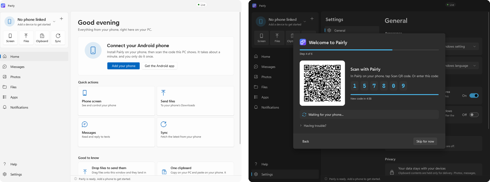

# Pairly

**Dein Android-Handy auf deinem Windows-PC.** 
Nachrichten, Benachrichtigungen, Fotos, Dateien, eine gemeinsame Zwischenablage und dein Handybildschirm, privat über dein eigenes WLAN.

[English](README.md) · [Datenschutz](PRIVACY.md) · [Releases](https://github.com/TheTobiTiger02/Pairly/releases)

## Was du damit machen kannst

| | |
| --- | --- |
| 💬 **Nachrichten** | Lies deine SMS-Unterhaltungen und antworte über die Tastatur. |
| 🔔 **Benachrichtigungen** | Sieh die Benachrichtigungen deines Handys am PC, antworte darauf und schalte unwichtige Apps stumm. |
| 🖼️ **Fotos** | Durchsuche Fotos und Videos auf deinem Handy und speichere sie auf dem PC. |
| 📁 **Dateien** | Schicke Dateien in beide Richtungen zwischen Handy und PC. |
| 📋 **Zwischenablage** | Auf einem Gerät kopieren, auf dem anderen einfügen, für Text und Bilder, mit allen verbundenen Handys. |
| 📱 **Handybildschirm** | Spiegle dein Handy in einem Fenster und steuere es mit Maus und Tastatur. |
| 📞 **Anrufe** | Sieh, wer anruft, und nimm Anrufe am PC an oder lehne sie ab. |
| 👥 **Mehrere Handys** | Verbinde mehrere Android-Handys mit einem PC und wechsle zwischen ihnen. |

Kein Konto, keine Cloud, keine Werbung, kein Tracking. Deine Daten fließen nur zwischen deinen eigenen Geräten, über eine verschlüsselte Verbindung, die fest an deinen PC gebunden ist. Beide Apps gibt es auf **Deutsch und Englisch**.

## In 3 Schritten startklar

1. **Installiere Pairly auf deinem PC.** Über den [Microsoft Store](https://apps.microsoft.com/detail/9NDLWS4D52HM) (empfohlen) oder mit [`Pairly-Setup.exe`](https://github.com/TheTobiTiger02/Pairly/releases/latest/download/Pairly-Setup.exe). Die Setup-Datei braucht keine Administratorrechte und aktualisiert sich selbst. Nutze nur eine der beiden Varianten.
   > Die Setup-Datei ist nicht signiert, deshalb warnt Windows SmartScreen einmal: Wähle **Weitere Informationen → Trotzdem ausführen**. Die Store-Version zeigt keine Warnung.
2. **Installiere Pairly auf deinem Handy.** Lade [`Pairly.apk`](https://github.com/TheTobiTiger02/Pairly/releases/latest/download/Pairly.apk) auf dem Handy herunter (oder scanne den QR-Code, den die PC-App zeigt) und erlaube die Installation aus deinem Browser, wenn Android fragt. Ab Android 8.0.
3. **Kopple die beiden.** Beim ersten Start führen dich beide Apps durch alles: Scanne den QR-Code am PC mit deinem Handy und schalte dann die Funktionen ein, die du willst. Handy und PC müssen im selben Netzwerk sein.

Beide Apps halten sich selbst aktuell und zeigen nach einem Update, was neu ist.

<b>Optional: Zwischenablage im Hintergrund auf Android</b>

Android lässt nur die App auf die Zwischenablage zugreifen, die gerade im Vordergrund ist. Damit auch Kopien aus anderen Apps synchronisiert werden, nutzt Pairly [Shizuku](https://shizuku.rikka.app/). Die Android-App hat dafür unter **Funktionen → Zwischenablage** eine bebilderte Schritt-für-Schritt-Anleitung. Ohne Shizuku wird die Zwischenablage synchronisiert, solange Pairly geöffnet ist, und du kannst sie jederzeit über das Teilen-Menü, die Benachrichtigung oder die Schnelleinstellungen senden.

## Hilfe

- **Das Handy findet den PC nicht.** Prüfe, ob beide im selben WLAN sind (kein Gastnetz), und erlaube Pairly in der Windows-Firewall für **private** Netzwerke, wenn Windows fragt.
- **Die Verbindung bricht im Hintergrund ab.** Erlaube Pairly, ohne Akku-Einschränkungen zu laufen. Unter **Funktionen → Hintergrund** gibt es dafür einen Button.
- Weitere Antworten findest du unter **Hilfe** in beiden Apps. Einen Fehler gefunden? [Erstelle ein Issue](https://github.com/TheTobiTiger02/Pairly/issues).

Informationen für Entwickler (Build, Aufbau, Releases) stehen in der [englischen README](README.md#for-developers).
