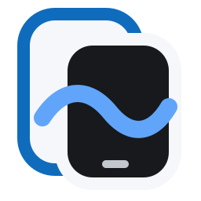
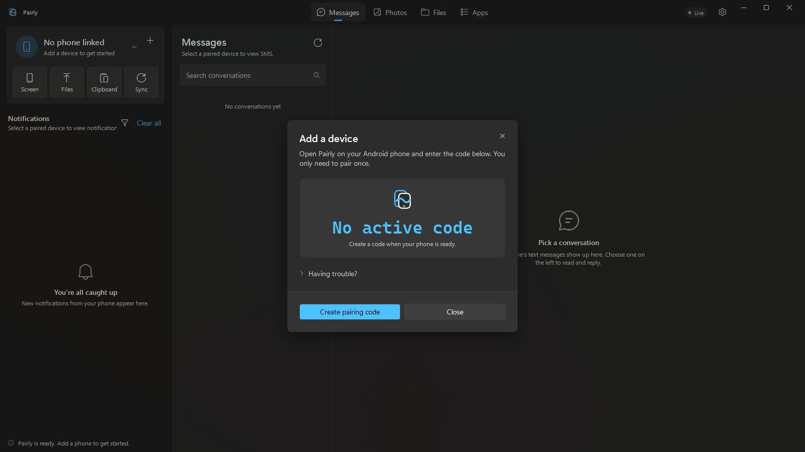
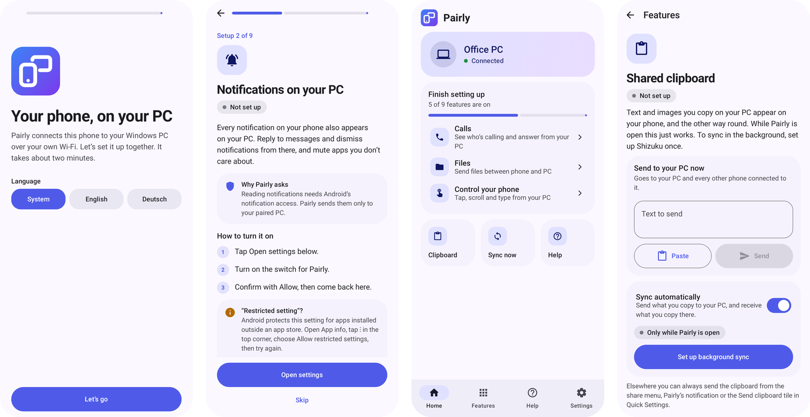
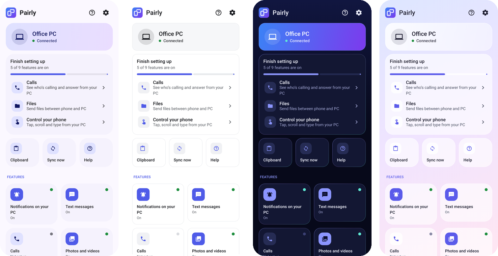

<div align="center">



# Pairly

**Your Android phone, on your Windows PC.**<br>
Messages, notifications, photos, files, a shared clipboard and your phone's screen, privately over your own Wi-Fi.

[Deutsch](README.de.md) · [Privacy](PRIVACY.md) · [Releases](https://github.com/TheTobiTiger02/Pairly/releases)

<a href="https://apps.microsoft.com/detail/9NDLWS4D52HM"></a>

<a href="https://github.com/TheTobiTiger02/Pairly/releases/latest/download/Pairly-Setup.exe"></a>
<a href="https://github.com/TheTobiTiger02/Pairly/releases/latest/download/Pairly.apk"></a>

[](https://github.com/TheTobiTiger02/Pairly/releases/latest)
[](https://github.com/TheTobiTiger02/Pairly/actions/workflows/ci.yml)





</div>

## What you can do

| | |
| --- | --- |
| 💬 **Messages** | Read your SMS conversations and reply from your keyboard. |
| 🔔 **Notifications** | See your phone's notifications on your PC, reply, and mute the apps you don't care about. |
| 🖼️ **Photos** | Browse your phone's photos and videos and save them to your PC. |
| 📁 **Files** | Send files between phone and PC in either direction. |
| 📋 **Clipboard** | Copy on one device, paste on another, for text and images, with every connected phone. |
| 📱 **Phone screen** | Mirror your phone in a window and control it with mouse and keyboard. |
| 📞 **Calls** | See who's calling and answer or decline from your PC. |
| 👥 **Several phones** | Connect multiple Android phones to one PC and switch between them. |

No account, no cloud, no ads, no tracking. Everything travels only between your own devices over an encrypted connection pinned to your PC. Both apps are available in **English and German**.

## Get started in 3 steps

1. **Install Pairly on your PC.** Use the [Microsoft Store](https://apps.microsoft.com/detail/9NDLWS4D52HM) (recommended), or [`Pairly-Setup.exe`](https://github.com/TheTobiTiger02/Pairly/releases/latest/download/Pairly-Setup.exe), which installs without admin rights and updates itself. Use one or the other, not both.
   > The installer is not code-signed, so Windows SmartScreen warns once: select **More info → Run anyway**. The Store version has no warning.
2. **Install Pairly on your phone.** Download [`Pairly.apk`](https://github.com/TheTobiTiger02/Pairly/releases/latest/download/Pairly.apk) on the phone (or scan the QR code the PC app shows) and allow installing from your browser when Android asks. Android 8.0 or newer.
3. **Pair them.** Both apps walk you through it the first time: scan the QR code on the PC with your phone, then turn on the features you want. Phone and PC must be on the same network.

Both apps keep themselves up to date. After an update they show what's new.

<details>
<summary><b>Optional: background clipboard sync on Android</b></summary>

Android only lets the app that's on screen read the clipboard. To sync copies made in any app, Pairly uses [Shizuku](https://shizuku.rikka.app/). The Android app has an illustrated step-by-step guide under **Features → Clipboard**. Without Shizuku, the clipboard still syncs while Pairly is open, and you can send it any time from the share sheet, the notification, or the Quick Settings tile.
</details>

## Help

- **The phone can't find the PC.** Make sure both are on the same Wi-Fi (not a guest network), and allow Pairly through the Windows firewall for **private** networks when Windows asks.
- **The connection drops in the background.** Allow Pairly to run without battery restrictions. The app has a button for it under **Features → Background**.
- More answers are in **Help** inside both apps. Found a bug? [Open an issue](https://github.com/TheTobiTiger02/Pairly/issues).

---

## For developers

Windows: WPF (.NET 9, [WPF-UI](https://github.com/lepoco/wpfui), MVVM) with an embedded ASP.NET Core host. Android: Kotlin and Jetpack Compose (Material 3). Screen mirroring uses WebRTC, MediaProjection and WebView2.

### Repository layout

| Path | Contents |
| --- | --- |
| `src/shared/Pairly.Protocol` | Versioned JSON envelopes and payload contracts |
| `src/shared/Pairly.Core` | Trust, clipboard, media, notification, SMS, transfer and permission services |
| `src/windows/Pairly.Server` | Loopback management API and pinned LAN WSS device transport |
| `src/windows/Pairly.Windows` | The desktop app (normal Windows entry point) |
| `src/windows/Pairly.Host` | Optional server-only developer wrapper |
| `src/android` | Android app (`app`), ADB-mode server (`server`) and shared streaming code (`streamcore`) |
| `tests/Pairly.Tests` | Dependency-free .NET protocol, core and server tests |
| `scripts`, `packaging` | Release build and MSIX packaging |
| `docs` | Architecture, protocol, testing and [release](docs/releasing.md) docs |

### Build and test

```powershell
dotnet build Pairly.sln --configuration Release
dotnet run --project tests/Pairly.Tests/Pairly.Tests.csproj --configuration Release

cd src\android
.\gradlew.bat :app:testDebugUnitTest :app:assembleDebug
.\gradlew.bat :app:recordRoborazziDebug   # re-render the screenshot tests after UI changes
```

Launch only `Pairly.Windows.exe`; it owns the embedded host.

### Design preview

The Android app ships four candidate designs (Expressive, Minimal, Dark vibrant, Glass) and two navigation styles (bottom bar, dashboard). Unlock the switcher by tapping **Settings → Version** seven times. The Windows app can switch between a left navigation pane and top tabs the same way (click the version seven times). CI renders every Android screen in every design, light and dark, English and German, and attaches them to each run as the `android-screenshots` artifact.



### Releasing

**Actions → Release → Run workflow → patch / minor / major.** That builds and publishes the APK, the Windows installer and the Store package, and submits to the Microsoft Store. One-time setup and details are in [docs/releasing.md](docs/releasing.md). Never replace the Android signing key: installed apps can't update across a key change.

### Security boundaries

- Management, media-download and mirror-viewer HTTP endpoints are loopback-only.
- Phones use certificate-pinned WSS and authenticate with a nonce challenge; the trust secret is never sent on reconnect.
- Windows protects trust secrets with DPAPI and redundant checksummed snapshots; Android stores the trusted host encrypted with the Android Keystore.
- Clipboard contents are ephemeral and memory-bounded; history keeps delivery metadata, not clipboard content.
- Release Android builds disable cleartext traffic.
